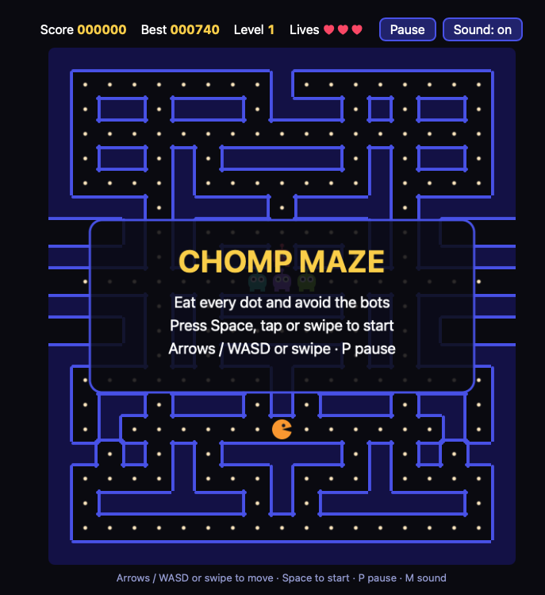

# 🟠 Chomp Maze

A maze-chase arcade game built with HTML5 Canvas and vanilla JavaScript. Eat every dot, avoid the bots, grab the power pellets to turn the tables, and clear three levels to win.

🎮 **[Play the game](https://game-pacman-pink.vercel.app/)**



Every character is drawn in code and every sound is generated by the browser: the project uses **no image or audio files**.

---

## ✨ Features

- 🎯 Three levels with different wall colors, each one a little faster
- 🤖 Four bots with different behaviors
- ⚡ Power pellets: the bots get scared and can be eaten for bonus points
- 🍒 Bonus fruit on levels 2 and 3
- 🕳️ Side tunnel: the characters come out on the other side of the board
- 🏆 High score saved in the browser (`localStorage`)
- 🔊 Sound effects made with the Web Audio API (mute with **M**)
- ⏸️ Pause, plus an automatic pause when you leave the tab
- 📱 **Responsive**: the board fits any screen, with swipe and on-screen arrow controls on touch devices

## 🕹️ Controls

| Action | Keyboard | Touch screen |
|---|---|---|
| Move | Arrow keys or W A S D | Swipe on the board, or use the arrow buttons |
| Start / play again | Space or Enter | Tap the board |
| Pause / resume | P or Esc | Pause button |
| Sound on / off | M | Sound button |

You can press a direction **before** a turn is possible: the game remembers it for half a second and turns as soon as the path opens.

## 📜 Rules

| Item | Points |
|---|---|
| Dot | 10 |
| Power pellet | 50, and the bots are scared for 10 seconds |
| Bot eaten while scared | 200, then 400, 800 and 1600 in a row |
| Fruit | 100 (optional bonus) |

- You have **3 lives**. Touching a bot while it is not scared costs one life.
- A level ends when all dots and power pellets are eaten.
- Clear level 3 to win.

### The bots

| Color | Behavior |
|---|---|
| Red | Chases you directly |
| Violet | Aims a few tiles ahead of you |
| Teal | Unpredictable |
| Green | Chases you from far away, but keeps its distance when you are close |

## 🛠️ Technologies

- **HTML5 Canvas** for all the drawing
- **CSS3**: `aspect-ratio`, media queries (`pointer: coarse`, `orientation`), flexbox and grid
- **JavaScript (ES6)**: classes, Pointer Events for swipes, `localStorage`
- **Web Audio API** for the sounds
- A **fixed-timestep game loop** with `requestAnimationFrame` and smooth movement between ticks

## 🚀 Run it locally

```bash
   git clone https://github.com/Yelle-stack/Game-pacman.git
   cd Game-pacman```

Then open `index.html` in your browser. No installation or build step is needed.

## 📁 Project structure

```
├── index.html     # Page, score bar and on-screen arrows
├── pacman.css     # Layout and responsive rules
├── pacman.js      # Game logic and drawing
├── favicon.svg
└── favicon.png
```

## ⚙️ Easy to customize

The main settings are at the top of `pacman.js`:

```js
const START_LIVES = 3;
const SCARED_TICKS = 200;      // how long the bots stay scared (20 ticks = 1 second)
const BASE_TICK_MS = 50;       // game speed on level 1
const TICK_MS_PER_LEVEL = 4;   // each level is this much faster
```

The levels are lists of text rows, so you can design your own maze:

```
X = wall   O = outside   (space) = dot   W = power pellet   C = fruit
P = player   r p b o = the four bots
```

## 🔮 Possible improvements

- More levels, and a level selection screen
- Different bot speeds and a "scatter" mode
- Online leaderboard
- Installable app (PWA) for phones

## 📄 License

The code is released under the MIT License (see `LICENSE`).

## 👩🏻‍💻 Author

**Jelena Zeko** – Full-Stack Developer
GitHub: [@Yelle-stack](https://github.com/Yelle-stack)
